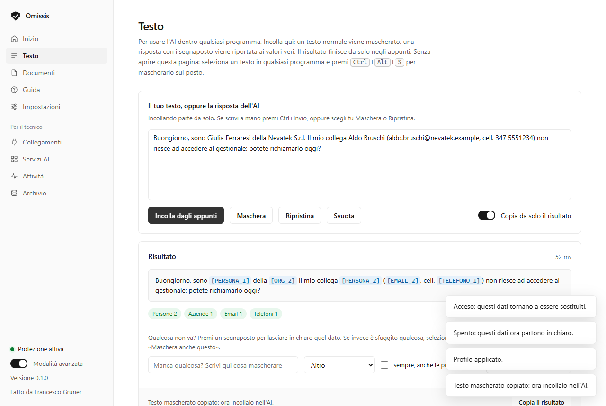
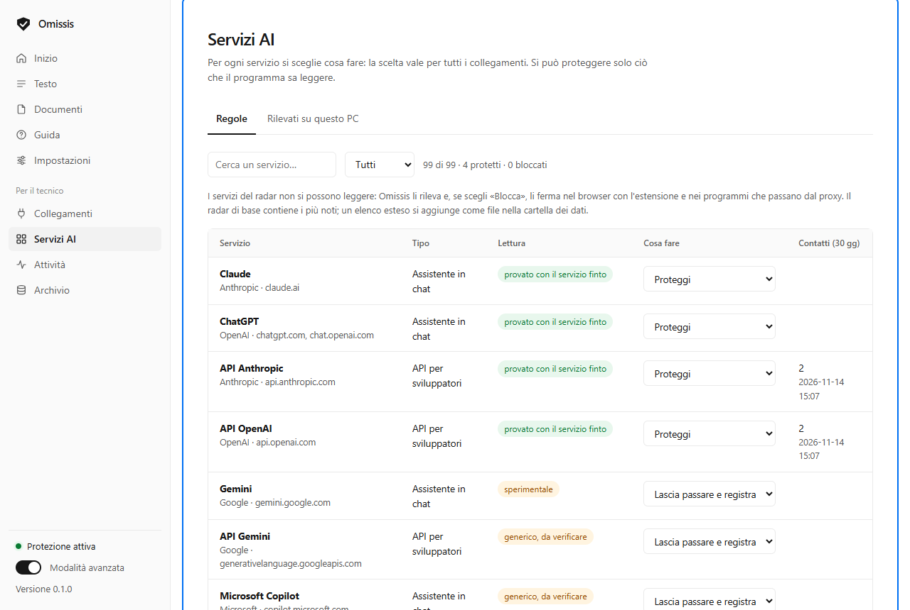
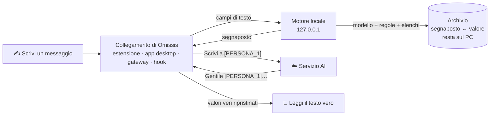

<div align="center">


# Omissis

**Usare gli assistenti AI senza consegnare loro i dati personali.**

[](LICENSE)
[](#-installazione-windows)
[](https://www.python.org/)
[](https://huggingface.co/francescogruner)
[](docs/BENCHMARKS.md)
<br>
[](#-come-funziona)
[](SECURITY.md)
[](#)
[](#-cosa-funziona-oggi)
[](https://omissis.eu)

[English](README.md) · **Italiano**

[Cosa fa](#-cosa-fa) · [Cosa funziona oggi](#-cosa-funziona-oggi) · [Come funziona](#-come-funziona) · [Il modello](#-il-modello) · [Installazione](#-installazione-windows) · [Limiti](#%EF%B8%8F-da-cosa-omissis-non-protegge) · [In arrivo](#%EF%B8%8F-in-arrivo)

</div>

---

Omissis sostituisce nomi, email, telefoni, codici fiscali, IBAN, password, nomi di dispositivi e altri dati
sensibili con segnaposto (`[PERSONA_1]`, `[EMAIL_3]`…) **prima** che il messaggio esca dal computer, e rimette i
valori veri nella risposta. Chi scrive legge il testo vero; il servizio AI vede soltanto segnaposto.

```text
Scrivi:            Scrivi a Giulia Ferraresi (giulia.ferraresi@nevatek.example) per il rimborso su IT60X0542811101000000123456
Il servizio vede:  Scrivi a [PERSONA_1] ([EMAIL_1]) per il rimborso su [IBAN_1]
Risponde:          Gentile [PERSONA_1], il rimborso su [IBAN_1] ...
Tu leggi:          Gentile Giulia Ferraresi, il rimborso su IT60X0542811101000000123456 ...
```

Tutto gira sul tuo PC: il modello che riconosce i dati, l'archivio dei segnaposto, il pannello. Nulla viene mandato a
un server di Omissis, perché non esiste. ChatGPT, Claude, Copilot e gli altri si usano **come sempre, con i propri
abbonamenti**: niente chiavi API, niente account nuovi. (Un'organizzazione può collegare i suoi PC a una console
propria: di serie è spento, partono solo conteggi, e il pannello mostra esattamente che cosa parte.)

<p align="center">
  
  
</p>
<p align="center">
  
  
</p>

## ✨ Cosa fa

| | |
|---|---|
| 🛡️ **Maschera prima dell'invio** | Nel browser, nelle app desktop, negli strumenti da terminale: il testo viene controllato sul PC e parte con i segnaposto |
| 🔁 **Ripristina la risposta** | I valori veri tornano mentre la risposta arriva; anche una conversazione riaperta giorni dopo si ripristina |
| 📎 **Anche gli allegati** | Word, Excel, PowerPoint, testo, PDF e immagini con testo: al servizio arriva la copia anonimizzata |
| 📄 **Documenti e cartelle** | Trascini un file o una cartella nel pannello e ottieni la copia anonimizzata; poi rimetti i valori veri nel risultato |
| ⌨️ **Qualsiasi programma** | Selezioni un testo ovunque e premi `Ctrl+Alt+S`; mascheri e ripristini gli appunti con due scorciatoie |
| 🚦 **Una regola per servizio** | Proteggi, registra, blocca o ignora ogni servizio AI; vedi quali contatta il PC (Shadow AI) |
| 🏢 **Pronto per molti PC** | Installazione silenziosa, impostazioni bloccate e stato da RMM, Intune o script di accesso; console centrale facoltativa |
| 🇮🇹 **Pensato per l'italiano** | Il modello è addestrato su dati italiani (codici fiscali, partite IVA, IBAN, indirizzi) e lavora in 23 lingue |

## ✅ Cosa funziona oggi

**Dal vivo** vuol dire sul servizio vero, con dati inventati, controllando che cosa è davvero uscito dal PC.

| | Dove | Stato |
|---|---|---|
| 🌐 | **Estensione del browser** su Edge: Claude, ChatGPT, Perplexity, Gemini, Copilot per Microsoft 365, Le Chat, Grok, Qwen, Poe, Manus, Genspark, Kimi, Z.ai (Chrome e Brave hanno lo stesso motore) | ✅ dal vivo, 17/11/2026 |
| 📎 | Allegati nel browser (un file Word su ChatGPT) | ✅ dal vivo |
| 🖥️ | App desktop: **ChatGPT**, **Perplexity**, **Microsoft Copilot** (connettore), **Antigravity** (con i suoi hook) | ✅ dal vivo |
| ⌨️ | Terminale: **Claude Code** (gateway e plugin), **Codex** (gateway), **Antigravity CLI** (hook) | ✅ dal vivo |
| 📄 | Documenti dentro le app AI (server MCP) con Claude Code; scorciatoie da tastiera sugli appunti | ✅ dal vivo |
| 🧪 | Kimi (plugin), opencode, aider e gli strumenti compatibili con OpenAI o Anthropic (gateway), Gemini CLI (plugin) | 🧪 prove automatiche |
| ⏳ | App desktop di Claude, plugin di Codex (va approvato con `/hooks`), MCP dentro Claude Desktop | ⏳ da provare |
| 🚫 | Copilot dentro Teams e Outlook, chat di Cursor e Windsurf (solo documenti, con MCP), Firefox, macOS, Linux | ❌ non coperti |

L'elenco completo e datato è su [omissis.eu](https://omissis.eu) e, per il tuo PC, nel pannello (*Collegamenti →
Compatibilità*), che annota anche con quale versione di ogni programma la sostituzione ha funzionato l'ultima volta.

## 🔧 Come funziona



Se il motore non risponde, le richieste verso i servizi protetti vengono **bloccate**, mai inoltrate in chiaro.

| Parte | A cosa serve |
|---|---|
| **Modello** (`model/`) | Riconosce i dati personali, prima di tutto in italiano: un classificatore su [mmBERT](https://huggingface.co/jhu-clsp/mmBERT-base) con 41 etichette (28 identificativi sempre mascherati, altre 13 a richiesta), più regole con controllo delle cifre (codice fiscale, partita IVA, IBAN, carte) ed elenchi personalizzabili |
| **Motore** (`app/engine.py`) | Servizio locale su `127.0.0.1`: maschera il testo e tiene in SQLite, cifrata con la protezione dei dati di Windows, la corrispondenza stabile *segnaposto ↔ valore* |
| **Estensione del browser** (`app/extension/`) | Chrome, Edge e Brave. Lavora dentro la pagina, prima che la richiesta venga cifrata: niente proxy, niente certificato. Protegge la casella di scrittura, le richieste e gli allegati; registra le visite ai servizi AI e può bloccarli |
| **Connettore per le app desktop** (`app/connector.py`) | Porta lo stesso codice dell'estensione dentro le app desktop basate su Chromium (ChatGPT, Perplexity, Claude, Copilot) attraverso la porta di debug. Se l'app è già aperta senza protezione lo segnala e, a richiesta, la riapre protetta |
| **Plugin e hook** (`app/ai_hook.py`) | Per le app che hanno un loro sistema di hook (Claude Code, Codex, Kimi, Gemini CLI, Antigravity): ogni messaggio viene controllato prima dell'invio, e quello con dati personali viene fermato, con la versione protetta negli appunti. I plugin sono in [`plugins/`](plugins/README.it.md), in questo stesso repository |
| **Gateway per il terminale** (`app/gateway.py`) | Per Claude Code, Codex, opencode, aider e ogni strumento a cui si può indicare l'indirizzo del servizio: `http://127.0.0.1:8767/<servizio>`. Maschera messaggi, risultati degli strumenti e azioni già fatte; ripristina il testo e gli argomenti delle nuove azioni. Funziona con l'accesso in abbonamento e può stare davanti a un gateway che si ha già |
| **Server MCP** (`app/mcp_server.py`) | Per Claude Desktop, Claude Code, Codex, Cursor, Windsurf, Antigravity e le altre app che parlano MCP: l'assistente fa leggere i documenti a Omissis e riceve solo il testo con i segnaposto; il ripristino scrive sul PC e non restituisce mai i valori veri |
| **Proxy** (`app/addon.py`) | Addon di [mitmproxy](https://mitmproxy.org) per i programmi che parlano con le API o accettano un proxy con un certificato locale |
| **Uso manuale** | Mascherare e ripristinare un testo incollato e correggere il risultato a mano; scorciatoie sugli appunti registrate come scorciatoie di Windows (il programma non vede gli altri tasti); anonimizzare e ripristinare Word, Excel, PowerPoint, file di testo e cartelle intere; PDF scansionati e immagini si leggono con il riconoscimento dei caratteri di Windows |
| **Pannello** (`app/panel.py`) | Pagina locale e icona vicino all'orologio, in italiano e in inglese. Una modalità *semplice* per tutti i giorni e una *avanzata* per chi lo gestisce: registro delle attività (solo conteggi, mai i testi), regola per servizio, archivio dei segnaposto, inventario degli strumenti AI sul PC |
| **Inventario degli strumenti AI** (`app/scan.py`, `app/inventory.py`) | App AI installate, estensioni del browser e dell'editor, comandi da terminale, modelli in locale, servizi contattati: ogni analisi viene salvata e confrontata con la precedente, con un giudizio per ogni voce ed esportazione in CSV. Solo nomi, versioni e date, tutto in locale |

## 🧠 Il modello

Due taglie, stesse etichette e stessi dati di addestramento: circa un milione di testi, cioè 200.000 documenti
sintetici in italiano scritti dal nostro generatore e le parti di addestramento di nove raccolte pubbliche in 23
lingue. Tutto è sintetico, tranne due raccolte di sentenze che contengono nomi già pubblici negli atti.

| | Parametri | Dimensione | Tempo su processore* |
|---|---|---|---|
| [`omissis-base`](https://huggingface.co/francescogruner/omissis-base) | 307,8 M | 1,2 GB | circa 61 ms |
| [`omissis-small`](https://huggingface.co/francescogruner/omissis-small) | 140,9 M | 537 MB | circa 26 ms |

\* per un testo breve, su un processore da scrivania.

Su un insieme privato di 2.000 testi reali di assistenza informatica (non pubblicabile; le soglie sono state scelte
su un secondo insieme tenuto a parte), misurando *quanti dei valori sensibili noti risultano mascherati*, e sul
benchmark pubblico [PIIMB](https://huggingface.co/datasets/piimb/pii-masking-benchmark) (circa 150.000 frasi in sei
gruppi, a livello di carattere, solo i pesi del modello):

| | Valori noti protetti | Testo mascherato | Nomi di azienda in testo libero | PIIMB, F2 medio |
|---|---|---|---|---|
| `omissis-base` | 98,8 % | 17,0 % | 94 % | 0,911 |
| `omissis-small` | 98,8 % | 17,2 % | 92 % | **0,912** |

Misure del 13 novembre 2026. Il migliore degli altri 36 modelli in elenco su PIIMB ottiene in media 0,836; i nostri
sono primi in media, non in ogni gruppo, e le parti di addestramento delle stesse raccolte sono tra i loro dati di
addestramento (quelle di prova non sono mai state usate). Il confronto con il privacy-filter di OpenAI, Presidio e i
migliori della classifica pubblica è in [docs/BENCHMARKS.md](docs/BENCHMARKS.md) (in inglese).

Cosa questi numeri **non** dicono: la precisione sui testi reali non è ancora misurata (serve un insieme etichettato
a mano, in preparazione), e i "valori noti" sono quelli ricavabili dai dati dei ticket, non tutti i dati sensibili
presenti nel testo. Dettagli e limiti nelle schede del modello in [`huggingface/`](huggingface/).

I pesi si scaricano da Hugging Face con `model/download_model.py`; non stanno in questo repository.

## 🚀 Installazione (Windows)

> [!TIP]
> **Lascia fare a un agente AI.** Se sul PC hai un agente che sa usare il terminale (Claude Code, Codex,
> Antigravity, Cursor, Copilot, Kimi), dagli questa frase: a ogni passo ti chiede conferma.
>
> *Installa Omissis su questo PC seguendo passo per passo le istruzioni in https://omissis.eu/install.txt.
> Chiedimi conferma prima di ogni passo che cambia qualcosa sul computer, non usare diritti di amministratore, e
> alla fine dimmi che cosa hai fatto e che cosa resta da fare a me.*
>
> Le istruzioni che l'agente segue sono in [INSTALL-FOR-AGENTS.md](INSTALL-FOR-AGENTS.md), in inglese.

**Requisiti:** Windows 10 (versione 2004 o successiva) o Windows 11 a 64 bit su processore Intel o AMD, 4 core,
8 GB di memoria con `omissis-small` (16 GB per `omissis-base`), da 1 a 2 GB di disco. Non serve una scheda video. Su
un normale PC da ufficio conviene `omissis-small`: la qualità misurata è quasi la stessa e va il doppio più veloce
(circa 0,1 s per un messaggio breve, 3 s per due pagine su un PC a 4 core; i dettagli nella
[guida](app/README.it.md)).

**📦 Con l'installer** (per chi vuole solo usarlo): dalla pagina delle
[versioni](https://github.com/francescogruner/omissis/releases/latest) si scarica `Omissis-<versione>-setup.exe`.
Non serve Python e non servono diritti di amministratore. Al primo avvio il programma scarica il modello (una volta
sola) e da lì in poi lavora senza rete; gli aggiornamenti arrivano da soli e vengono accettati solo se firmati
dall'autore. L'installer non ha ancora una firma del codice: Windows mostra l'avviso di SmartScreen.

**🛠️ Dai sorgenti** (per chi vuole leggere o modificare il codice): serve Python 3.12; programma e modello usano
due ambienti separati.

```bat
git clone https://github.com/francescogruner/omissis
cd omissis
py -3.12 -m venv app\.venv
app\.venv\Scripts\pip install -r app\requirements.txt
py -3.12 -m venv model\.venv
model\.venv\Scripts\pip install -r model\requirements-light.txt
model\.venv\Scripts\python model\download_model.py omissis-small
app\.venv\Scripts\python app\panel.py
```

Questa è l'**installazione leggera**: il modello gira sul processore in formato ONNX, senza PyTorch (circa 150 MB di
librerie invece di qualche GB), e trova esattamente gli stessi dati del motore PyTorch (lo controlla
`model/compare_engines.py`). Per usare la scheda grafica si installa invece `model\requirements.txt`.

Il pannello si apre su `http://127.0.0.1:8766`. Da lì: mascherare un testo a mano, anonimizzare documenti, caricare
e collegare l'estensione, collegare le app desktop e gli strumenti da terminale. Tutto il resto è in
[app/README.it.md](app/README.it.md).

### 🏢 Per aziende e MSP

- **Su molti PC:** gli script in [`deploy/`](deploy/README.it.md) installano Omissis in silenzio e già configurato,
  bloccano le impostazioni scelte dall'amministratore, ne riferiscono lo stato e lo tolgono, da un RMM, da Intune o
  da uno script di accesso. Si parte dalla [guida per le aziende](deploy/GUIDA-AZIENDE.it.md).
- **Tutti i PC in una pagina:** la [console centrale](console/README.it.md) mostra, azienda per azienda, quali PC
  sono protetti e quanti dati sono stati tenuti fuori dai servizi AI. È un programma a parte, compilato e non
  aperto, **gratuito fino a 5 PC**.
- **PC che non reggono il modello:** un PC con Omissis può prestare il suo modello agli altri della rete. Il testo
  viaggia cifrato e tornano solo le posizioni dei dati trovati; segnaposto, valori veri, regole ed elenchi restano
  su ogni PC. Di serie è spento.

## ⚠️ Da cosa Omissis non protegge

Meglio conoscere i limiti prima di contarci:

- **È un filtro, non una garanzia.** Un modello può non riconoscere un dato. Per i termini che non può conoscere
  (nomi di progetti riservati, codici interni) c'è l'elenco «da mascherare sempre»; le prime prove vanno fatte con
  dati inventati.
- **Plugin e hook fermano, non riscrivono.** In Claude Code, Codex, Kimi e Antigravity il messaggio con dati
  personali viene fermato e la versione protetta finisce negli appunti, da incollare. Se il comando di Omissis
  manca, quelle app lasciano partire il messaggio.
- **I file che un agente legge da solo** sul PC vengono mascherati solo attraverso il gateway, non con plugin e hook.
- **Agli agenti per il codice viene mascherato molto contesto.** Attraverso il gateway il contenuto dei file e
  l'uscita dei comandi vengono mascherati per intero: protegge di più, ma nelle sessioni lunghe può confondere il
  modello.
- **I valori ripristinati sono visibili alla pagina.** Quando la risposta viene ripristinata dentro la pagina o
  l'app del servizio, gli script di quella pagina possono leggerla. Chi non lo vuole spegne il ripristino e usa le
  scorciatoie sugli appunti.
- **Non ancora coperti:** i file caricati da chi passa dal solo proxy o dal gateway (si possono bloccare), le
  richieste fatte dai processi secondari di una pagina. Un'immagine senza testo leggibile parte così com'è.
- **L'archivio è cifrato con la protezione dei dati di Windows**, legata al tuo utente: il file copiato altrove non
  si apre. Non protegge da un programma malevolo già in esecuzione nel tuo profilo.
- **Il connettore per le app desktop** usa la porta di debug dell'app, che il produttore può limitare quando vuole e
  che qualunque programma del PC può usare finché l'app è aperta.

Modello di minaccia e segnalazioni: [SECURITY.md](SECURITY.md).

## 🗺️ In arrivo

- [x] Estensione del browser verificata dal vivo su 13 servizi, con gli allegati
- [x] App desktop: ChatGPT, Perplexity, Microsoft Copilot, Antigravity
- [x] Terminale: Claude Code, Codex, Antigravity CLI
- [ ] Verifica dal vivo dell'app desktop di Claude
- [ ] Firma del codice dell'installer e Microsoft Store; estensione negli store dei browser
- [ ] Messaggistica nativa del browser al posto del collegamento HTTP locale per l'estensione
- [ ] Firefox
- [ ] Scansioni restituite come immagine oscurata; ripristino automatico dei file scaricati dalle chat
- [ ] Console centrale: avvisi e accesso con l'account Microsoft; Mac

## 🤝 Contribuire e segnalare problemi

Qualcosa non va con un servizio o con una nuova versione di un'app? Apri una
[segnalazione](https://github.com/francescogruner/omissis/issues) con il riepilogo del pannello (*Collegamenti →
Compatibilità → Copia il riepilogo*): contiene nomi, versioni e conteggi, mai i tuoi testi. **Non incollare mai
dati personali veri in una segnalazione.** Problemi di sicurezza: [SECURITY.md](SECURITY.md).

## 📜 Licenza

Codice e pesi del modello: [Apache License 2.0](LICENSE). Componenti di terze parti e loro licenze:
[THIRD_PARTY.md](THIRD_PARTY.md). Il nome «Omissis» come nome del prodotto non rientra nella licenza (articolo 6).

<div align="center">

Fatto in Italia da [Francesco Gruner](https://github.com/francescogruner) · [omissis.eu](https://omissis.eu)

</div>
