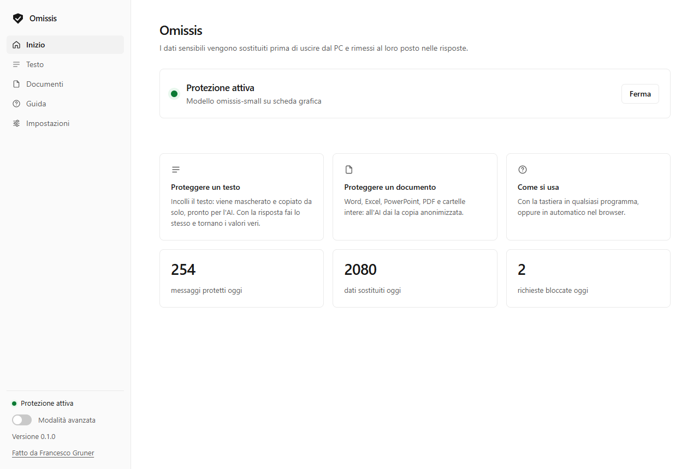
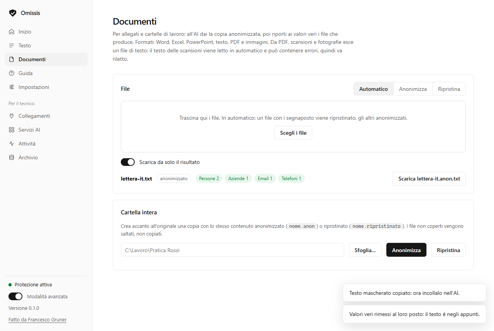
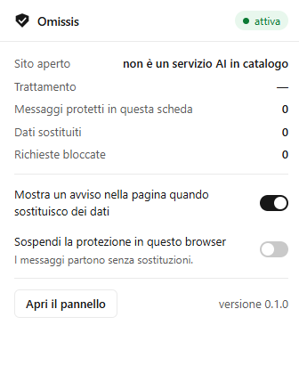

# Omissis

**Usare gli assistenti AI senza consegnare loro i dati personali.**
Omissis sostituisce nomi, email, telefoni, codici fiscali, IBAN, password, nomi di dispositivi e altri
dati sensibili con segnaposto (`[PERSONA_1]`, `[EMAIL_3]`…) *prima* che il messaggio esca dal
computer, e rimette i valori veri nella risposta. Chi scrive legge il testo vero; il servizio AI vede
soltanto segnaposto.

Tutto gira in locale: il modello che riconosce i dati, l'archivio dei segnaposto, il pannello. Nulla
viene mandato a un server di Omissis, perché non esiste. (Un'organizzazione può collegare i suoi PC a una
console propria: di serie è spento, partono solo conteggi, e il pannello mostra esattamente che cosa parte.)








> **Stato: beta.** Il modello è addestrato e misurato. I connettori superano le prove automatiche
> contro un servizio finto, ma **le verifiche dal vivo sono ancora poche**: il gateway per il terminale
> è stato verificato dal vivo con Claude Code (un messaggio semplice e un'azione che scrive un file); l'estensione del browser non è ancora stata verificata
> con account veri; il connettore per le app desktop, dopo aver fallito le prime prove dal vivo, ora maschera i
> messaggi nell'app vera di ChatGPT (verificato con un messaggio di dati inventati); Claude Desktop non è stato provato;
> il server MCP è stato provato dal vivo una volta con Claude Code (un verbale inventato), non ancora dentro Claude Desktop;
> Codex con l'accesso di ChatGPT e il gateway proprio sono provati solo contro un servizio finto. Le prime prove vanno fatte con dati inventati.

## Cosa c'è dentro

| Parte | A cosa serve |
|---|---|
| **Modello** (`model/`) | Riconosce i dati personali in testi italiani: un classificatore su [mmBERT](https://huggingface.co/jhu-clsp/mmBERT-base) con 41 etichette (28 identificativi sempre mascherati, altre 13 a richiesta), più regole con controllo delle cifre (codice fiscale, partita IVA, IBAN, carte) ed elenchi personalizzabili |
| **Motore** (`app/engine.py`) | Servizio locale su `127.0.0.1`: maschera il testo e tiene in SQLite la corrispondenza stabile *segnaposto ↔ valore*, così una conversazione riaperta giorni dopo si può ancora ripristinare |
| **Estensione del browser** (`app/extension/`) | Chrome ed Edge. Lavora dentro la pagina, prima che la richiesta venga cifrata: niente proxy, niente certificato. Registra anche le visite ai servizi AI e può bloccarli |
| **Gateway per il terminale** (`app/gateway.py`) | Per Claude Code, Codex, opencode, aider e ogni strumento a cui si può indicare l'indirizzo del servizio: `http://127.0.0.1:8767/<servizio>`. Maschera messaggi, risultati degli strumenti e azioni già fatte; ripristina il testo e gli argomenti delle nuove azioni. Funziona con l'accesso in abbonamento (Claude Code provato dal vivo; Codex con l'accesso di ChatGPT viene mandato all'indirizzo giusto, provato solo con un servizio finto) e può stare davanti a un gateway che si ha già. Senza certificato |
| **Server MCP** (`app/mcp_server.py`) | Sperimentale. Per Claude Desktop, Claude Code, Codex, Cursor, Windsurf, Antigravity e le altre app che parlano MCP, usate come sempre e con il proprio abbonamento: l'assistente fa leggere i documenti a Omissis e riceve solo il testo con i segnaposto; il ripristino scrive sul PC e non restituisce mai i valori veri. Protegge i documenti, non ciò che si scrive nella chat |
| **Connettore per le app desktop** (`app/connector.py`) | Sperimentale. Porta lo stesso codice dell'estensione dentro le app desktop basate su Chromium (Claude, ChatGPT, Copilot). Kimi rifiuta il collegamento: lì Omissis usa il sistema di plugin di Kimi stessa (`app/kimi_plugin.py`), che controlla ogni messaggio prima dell'invio e ferma quelli con dati personali; se l'app è già aperta senza protezione lo segnala e, a richiesta, la chiude e la riapre protetta |
| **Proxy** (`app/addon.py`) | Addon di [mitmproxy](https://mitmproxy.org) per i programmi che parlano con le API o accettano un proxy con un certificato locale |
| **Uso manuale** | Per qualsiasi app, senza leggere il traffico di nessuno. Si seleziona un testo ovunque e si preme `Ctrl+Alt+S`: viene mascherato sul posto. Mascherare e ripristinare un testo incollato e correggere il risultato a mano (lasciare in chiaro un dato, mascherarne uno sfuggito, una volta o per sempre), scorciatoie sugli appunti (`Ctrl+Alt+M`, `Ctrl+Alt+R`; tutte e tre modificabili, registrate come scorciatoie di Windows: il programma non vede gli altri tasti), anonimizzare e ripristinare Word, Excel, PowerPoint, file di testo e cartelle intere; PDF scansionati e immagini si leggono con il riconoscimento dei caratteri di Windows |
| **Pannello** (`app/panel.py`) | Pagina locale e icona vicino all'orologio. Una modalità *semplice* per l'uso di tutti i giorni (stato, testo, documenti, guida) e una *avanzata* per chi lo gestisce: registro delle attività (solo conteggi, mai i testi), scelta per servizio (proteggi / registra / blocca / ignora), inventario degli strumenti AI sul PC |
| **Archivio** (pannello) | Cercare un segnaposto o un valore vero senza mostrare gli altri, eliminare le voci scelte o quelle non usate da N giorni, pulizia automatica facoltativa. Un numero eliminato non viene mai riusato: un segnaposto vecchio non può tornare a indicare un altro valore |
| **Inventario degli strumenti AI** (`app/scan.py`, `app/inventory.py`) | Shadow AI sul PC, tenuto nel tempo: app AI installate, estensioni del browser e dell'editor, comandi da terminale, modelli in locale, servizi contattati. Ogni analisi (settimanale, se non si cambia) viene salvata e confrontata con la precedente: cosa è comparso, cosa non c'è più, da quando; un giudizio (approvato / da rimuovere) e una nota per ogni voce; esportazione in CSV. Solo nomi, versioni e date, tutto in locale |
| **Registro di compatibilità** (`app/compatibility.json` e pannello) | Siti e app cambiano senza avvisare. Il pannello annota, solo sul PC, con quale programma e quale versione ogni sostituzione ha funzionato l'ultima volta (browser, app desktop, strumento da terminale) e segnala quelle da ricontrollare dopo un aggiornamento; nomi, versioni e conteggi, mai i testi. `compatibility.json` elenca ciò che l'autore ha verificato di persona |

Se il motore non risponde, le richieste verso i servizi protetti vengono **bloccate**, mai inoltrate
in chiaro.

## Il modello

Due taglie, stesse etichette e stessi dati di addestramento: circa un milione di testi, cioè 200.000
documenti sintetici in italiano scritti dal nostro generatore e le parti di addestramento di nove
raccolte pubbliche in 23 lingue. Tutto è sintetico, tranne due raccolte di sentenze che contengono
nomi già pubblici negli atti.

| | Parametri | Dimensione | Tempo su processore* |
|---|---|---|---|
| `omissis-base` | 307,8 M | 1,2 GB | circa 61 ms |
| `omissis-small` | 140,9 M | 537 MB | circa 26 ms |

\* per un testo breve, su un processore da scrivania.

Su un insieme privato di 2.000 testi reali di assistenza informatica (non pubblicabile; le soglie
sono state scelte su un secondo insieme tenuto a parte), misurando *quanti dei valori sensibili noti
risultano mascherati*, e sul benchmark pubblico
[PIIMB](https://huggingface.co/datasets/piimb/pii-masking-benchmark) (circa 150.000 frasi in sei
gruppi, a livello di carattere, solo i pesi del modello):

| | Valori noti protetti | Testo mascherato | Nomi di azienda in testo libero | PIIMB, F2 medio |
|---|---|---|---|---|
| `omissis-base` | 98,8 % | 17,0 % | 94 % | 0,911 |
| `omissis-small` | 98,8 % | 17,2 % | 92 % | 0,912 |

Misure del 13 novembre 2026. Il migliore degli altri 36 modelli in elenco su PIIMB ottiene in media
0,836; i nostri sono primi in media, non in ogni gruppo, e le parti di addestramento delle stesse
raccolte sono tra i loro dati di addestramento (quelle di prova non sono mai state usate).

Il confronto dei due modelli con altri riconoscitori di dati personali (il privacy-filter di OpenAI,
Presidio, i migliori della classifica pubblica), sul benchmark pubblico, sull'italiano e sui testi reali, è in
[docs/BENCHMARKS.md](docs/BENCHMARKS.md) (in inglese).

Cosa questi numeri **non** dicono: la precisione sui testi reali non è ancora misurata (serve un
insieme etichettato a mano, in preparazione), e i "valori noti" sono quelli ricavabili dai dati dei
ticket, non tutti i dati sensibili presenti nel testo. Dettagli e limiti nelle schede del modello in
[`huggingface/`](huggingface/).

I pesi si scaricano da Hugging Face con `model/download_model.py`; non stanno in questo repository.

## Installazione (Windows)

**Requisiti:** Windows 10 (versione 2004 o successiva) o Windows 11 a 64 bit su processore Intel o
AMD, 4 core, 8 GB di memoria con `omissis-small` (16 GB per `omissis-base`), da 1 a 2 GB di disco.
Non serve una scheda video: la copia installata usa il processore. Su un normale PC da ufficio
conviene `omissis-small`: la qualità misurata è quasi la stessa e va il doppio più veloce (stima per
un PC a 4 core: circa 0,1 s per un messaggio breve, 3 s per due pagine; i dettagli nella
[guida](app/README.it.md)).

**Con l'installer** (per chi vuole solo usarlo): dalla pagina delle
[versioni](https://github.com/francescogruner/omissis/releases/latest) si scarica
`Omissis-<versione>-setup.exe`. Non serve Python e non servono diritti di amministratore. Al primo
avvio il programma scarica il modello (una volta sola) e da lì in poi lavora senza rete; gli
aggiornamenti arrivano da soli e vengono accettati solo se firmati dall'autore (si può scegliere
«avvisa soltanto» o «mai»). L'installer non ha ancora una firma del codice: Windows mostra l'avviso
di SmartScreen.

**Dai sorgenti** (per chi vuole leggere o modificare il codice): serve Python 3.12. Programma e
modello usano due ambienti separati.

```
git clone https://github.com/francescogruner/omissis
cd omissis
py -3.12 -m venv app\.venv
app\.venv\Scripts\pip install -r app\requirements.txt
py -3.12 -m venv model\.venv
model\.venv\Scripts\pip install -r model\requirements-light.txt
model\.venv\Scripts\python model\download_model.py omissis-small
app\.venv\Scripts\python app\panel.py
```

Questa è l'**installazione leggera**: il modello gira sul processore in formato ONNX, senza PyTorch
(circa 150 MB di librerie invece di qualche GB), e trova esattamente gli stessi dati del motore
PyTorch (lo controlla `model/compare_engines.py`). Per usare la scheda grafica si installa invece
`model\requirements.txt`.

Il pannello si apre su `http://127.0.0.1:8766`. Da lì: mascherare un testo a mano (sezione Testo),
anonimizzare documenti (Documenti), caricare e collegare l'estensione (Browser).
Tutto il resto è in [app/README.it.md](app/README.it.md).

**Su molti PC** (aziende, MSP): gli script in [`deploy/`](deploy/README.it.md) installano Omissis in silenzio e
già configurato, bloccano le impostazioni scelte dall'amministratore, ne riferiscono lo stato e lo tolgono, da
un RMM, da Intune o da uno script di accesso. Si parte dalla [guida per le aziende](deploy/GUIDA-AZIENDE.it.md):
che cosa è gratuito e che cosa no, quale schema scegliere, il server di inferenza passo per passo.

**Tutti i PC in una pagina**: la [console centrale](console/README.it.md) mostra, cliente per cliente, quali PC sono
protetti e quanti dati sono stati tenuti fuori dai servizi AI. È un programma a parte, compilato e non aperto,
**gratuito fino a 5 PC**: si scarica dalla [pagina delle versioni](https://github.com/francescogruner/omissis/releases/latest).

**PC che non reggono il modello**: un PC con Omissis può prestare il suo modello agli altri della rete
(Impostazioni, Riconoscimento, «Server di inferenza in rete»). Il testo da controllare viaggia cifrato e tornano
solo le posizioni dei dati trovati; segnaposto, valori veri, regole ed elenchi restano su ogni PC. Di serie è spento.

## Da cosa Omissis non protegge

- **È un filtro, non una garanzia.** Un modello può non riconoscere un dato. Per i termini che non può
  conoscere (nomi di progetti riservati, codici interni) c'è l'elenco «da mascherare sempre».
- **I valori ripristinati sono visibili alla pagina.** Quando la risposta viene ripristinata dentro la
  pagina o l'app del servizio, gli script di quella pagina possono leggerla. Chi non lo vuole spegne il
  ripristino e usa `Ctrl+Alt+R` sul testo copiato.
- **Allegati:** nell'estensione e nelle app desktop il file allegato viene sostituito con la copia anonimizzata
  (Word, Excel, PowerPoint, testo; PDF e immagini con testo diventano testo). Provato con il servizio finto, non
  ancora sui siti veri. Un'immagine senza testo leggibile parte così com'è.
- **Non ancora coperti:** i file caricati da chi passa dal solo proxy o dal gateway (si possono bloccare), il
  traffico WebSocket, le richieste fatte dai processi secondari di una pagina.
- **Agli agenti per il codice viene mascherato molto contesto.** Attraverso il gateway il contenuto dei
  file e l'uscita dei comandi vengono mascherati per intero: protegge di più, ma nelle sessioni lunghe
  può confondere il modello.
- **L'archivio è cifrato con la protezione dei dati di Windows**, legata al tuo utente: il file copiato
  altrove non si apre. Non protegge da un programma malevolo già in esecuzione nel tuo profilo.
- **Il connettore per le app desktop è sperimentale**: usa la porta di debug dell'app, che il
  produttore può limitare quando vuole e che qualunque programma del PC può usare finché l'app è aperta.

Modello di minaccia e segnalazioni: [SECURITY.md](SECURITY.md).

## In arrivo

- Verifica con gli account veri, servizio per servizio
- Messa a punto di ciò che viene mascherato nel contesto degli agenti per il codice
- Firma del codice dell'installer e pubblicazione sul Microsoft Store
- Messaggistica nativa del browser per l'estensione e pubblicazione sugli store; Firefox
- Scansioni restituite come immagine oscurata; ripristino automatico dei file scaricati dalle chat
- Console centrale: prove dal vivo di regole dalla console, avvisi e accesso con l'account Microsoft (fatti, provati in automatico); Mac

## Licenza

Codice e pesi del modello: [Apache License 2.0](LICENSE). Componenti di terze parti e loro licenze:
[THIRD_PARTY.md](THIRD_PARTY.md). Il nome «Omissis» come nome del prodotto non rientra nella licenza
(articolo 6).

Un progetto di [Francesco Gruner](https://github.com/francescogruner).
