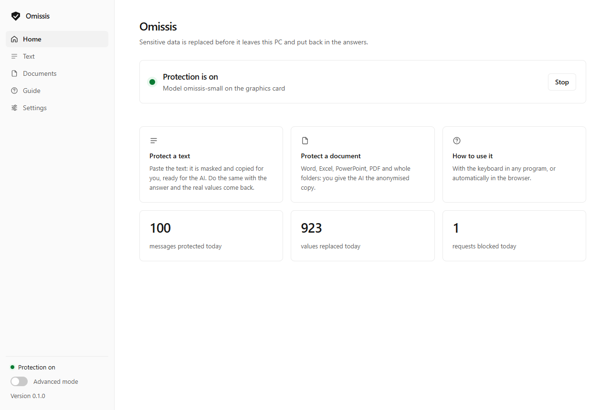
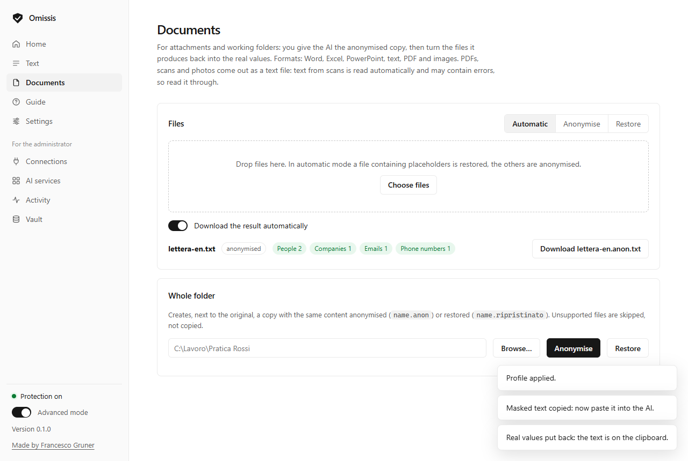
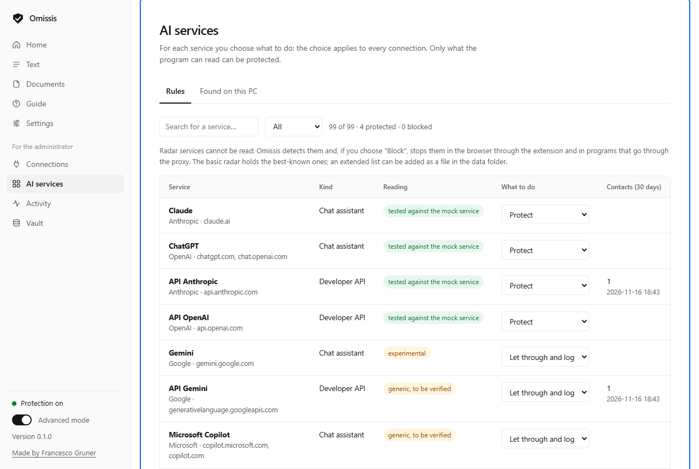
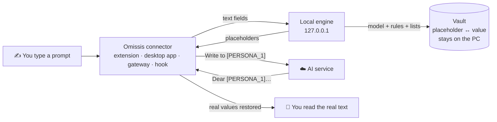

<div align="center">


# Omissis

**Use AI assistants without handing them your personal data.**

[](LICENSE)
[](#-quick-start-windows)
[](https://www.python.org/)
[](https://huggingface.co/francescogruner)
[](docs/BENCHMARKS.md)
<br>
[](#-how-it-works)
[](SECURITY.md)
[](#)
[](#-what-works-today)
[](https://omissis.eu)

**English** · [Italiano](README.it.md)

[What it does](#-what-it-does) · [What works today](#-what-works-today) · [How it works](#-how-it-works) · [The model](#-the-model) · [Quick start](#-quick-start-windows) · [Limits](#%EF%B8%8F-what-omissis-does-not-protect-you-from) · [Roadmap](#%EF%B8%8F-roadmap)

</div>

---

Omissis replaces names, e-mail addresses, phone numbers, tax codes, IBANs, passwords, host names and other
sensitive values with placeholders (`[PERSONA_1]`, `[EMAIL_3]`…) **before** a prompt leaves your computer, and
puts the real values back into the answer. You read the real text; the AI service only ever sees placeholders.

```text
You write:        Write to Giulia Ferraresi (giulia.ferraresi@nevatek.example) about the refund to IT60X0542811101000000123456
The AI receives:  Write to [PERSONA_1] ([EMAIL_1]) about the refund to [IBAN_1]
The AI answers:   Dear [PERSONA_1], the refund to [IBAN_1] ...
You read:         Dear Giulia Ferraresi, the refund to IT60X0542811101000000123456 ...
```

Everything runs on your PC: the detection model, the placeholder vault and the management panel. Nothing is sent to
an Omissis server, because there is none. You keep using ChatGPT, Claude, Copilot and the rest **as you always do,
with your own subscriptions**: no API keys, no new accounts. (An organisation can connect its PCs to a console of its
own: off by default, it sends counts only, and the panel shows exactly what leaves.)

In GDPR terms this is **pseudonymisation** (Article 4(5)): the data are replaced with placeholders, and the mapping
needed to put them back is kept separately, encrypted on your PC. The AI service only receives placeholders; for you
they remain personal data, because the vault links them back to the real values. In the panel the documents command
is called "Anonymise" because it is the better-known word, but this is what it means technically.

<p align="center">
  
  
</p>
<p align="center">
  
  
</p>

## ✨ What it does

| | |
|---|---|
| 🛡️ **Masks before sending** | In the browser, in desktop apps, in terminal tools: the text is checked on the PC and leaves with placeholders |
| 🔁 **Restores the answer** | Real values come back while the answer streams in; a conversation reopened days later can still be restored |
| 📎 **Attachments too** | Word, Excel, PowerPoint, text, PDF and images with text: the service receives the copy with placeholders |
| 📄 **Documents and folders** | Drop a file or a folder in the panel and get the copy with placeholders, then put the real values back in the result |
| ⌨️ **Any program** | Select text anywhere and press `Ctrl+Alt+S`; mask and restore the clipboard with two shortcuts |
| 🚦 **One rule per service** | Protect, log, block or ignore each AI service; see which ones the PC contacts (Shadow AI) |
| 🧭 **Guided first start** | Finds the AI tools on the PC, lets you tick what to protect and connects it; later, when you open an AI app for the first time, it asks what to do |
| 🏢 **Ready for many PCs** | Silent install, locked settings and status reports from RMM, Intune or a logon script; optional central console |
| 🇮🇹 **Italian first** | The model is trained on Italian data (tax codes, VAT numbers, IBANs, Italian addresses) and works in 23 languages |

## ✅ What works today

Verified **live** means on the real service, with made-up data, checking what actually left the PC.

| | Where | Status |
|---|---|---|
| 🌐 | **Browser extension** on Edge: Claude, ChatGPT, Perplexity, Gemini, Copilot for Microsoft 365, Le Chat, Grok, Qwen, Poe, Manus, Genspark, Kimi, Z.ai (Chrome and Brave share the same engine) | ✅ live, 17 Nov 2026 |
| 📎 | Attachments in the browser (a Word file on ChatGPT) | ✅ live |
| 🖥️ | Desktop apps: **ChatGPT**, **Perplexity**, **Microsoft Copilot** (connector), **Antigravity** (gateway, or its own hooks) | ✅ live |
| ⌨️ | Terminal: **Claude Code** (gateway and plugin), **Codex** (gateway), **Antigravity CLI** (gateway and hooks) | ✅ live |
| 📄 | Documents inside AI apps (MCP server) with Claude Code; keyboard shortcuts on the clipboard | ✅ live |
| 🧪 | Kimi (plugin), opencode, aider and OpenAI/Anthropic-compatible tools (gateway), Gemini CLI (plugin; Google retired it for personal accounts, it is left with an API key or Vertex AI only: Antigravity CLI, covered above, takes its place), MCP server in Cursor and Windsurf | 🧪 automated tests |
| ⏳ | Codex plugin (needs approval with `/hooks`), MCP inside Claude Desktop | ⏳ to be tested |
| 🖥️ | **Claude** desktop app on Windows: one button in the panel (*Connections → Apps → Protect Claude*) installs the Omissis certificate and sends only the traffic to claude.ai through Omissis. That way Omissis brings the extension's own code into the app window: on Enter the text is replaced in the writing box, in chat and in the Code tab, and the real values come back on screen. You use it as always, with your own sign-in. On a Mac the same road is tested automatically as far as the sign-in window | ✅ live, 23 Nov 2026 (6.28899.6) |
| 🚫 | Copilot inside Teams and Outlook, Cursor and Windsurf chat (documents go through the MCP server, see above), Firefox | ❌ not covered |
| 🍎 | **Mac** (Apple silicon): preview build 0.1.13, not signed with Apple. Built and tested automatically on a GitHub Mac; nobody has used it on a real Mac yet. It updates itself, starts at sign-in, reads scans and has the clipboard shortcuts. The first preview, 0.1.5, does not: if you have it, download the new one once. [How to install it](packaging/mac/README.md) | 🧪 preview |
| 🐧 | **Linux** (64-bit, x86): preview build 0.1.13. It installs with one command, without administrator rights, and then updates itself. Built and tested automatically on Ubuntu; nobody has used it on a real Linux desktop yet. Keyboard shortcuts are missing and, on stock Ubuntu, so is the icon next to the clock. [How to install it](packaging/linux/README.md) | 🧪 preview |

The full, dated list is on [omissis.eu](https://omissis.eu) and, for your own PC, in the panel (*Connections →
Compatibility*), which also records which program versions each replacement last worked with.

## 🔧 How it works



If the engine does not answer, protected requests are **blocked**, never forwarded in clear.

| Part | What it does |
|---|---|
| **Model** (`model/`) | Italian-first PII detector: a token classifier on [mmBERT](https://huggingface.co/jhu-clsp/mmBERT-base) with 41 labels (28 identifiers always masked, 13 more on request), plus checksum rules (tax code, VAT number, IBAN, cards) and allow/deny lists |
| **Engine** (`app/engine.py`) | Local service on `127.0.0.1`: masks text and keeps a stable vault *placeholder ↔ value* in SQLite, encrypted with Windows DPAPI |
| **Browser extension** (`app/extension/`) | Chrome / Edge / Brave, Manifest V3. Works inside the page, before the request is encrypted: no proxy, no certificate. Masks the composer, the requests and the attachments; logs visits to AI services and can block them |
| **Desktop-app connector** (`app/connector.py`) | Brings the same extension code into Chromium-based desktop apps (ChatGPT, Perplexity, Copilot) through the debugging port. If the app is already open without protection it says so and, on request, reopens it protected. The Claude app refuses the debugging port: the panel says so and leaves the app alone |
| **Plugins and hooks** (`app/ai_hook.py`) | For apps with a hook system of their own (Claude Code, Codex, Kimi, Gemini CLI, Antigravity): every message is checked before it is sent, and one with personal data is stopped, with the protected version on the clipboard. The plugins are in [`plugins/`](plugins/README.md), in this same repository |
| **Terminal gateway** (`app/gateway.py`) | For Claude Code, Codex, Antigravity (CLI and app), opencode, aider and any tool with a configurable base URL: point it at `http://127.0.0.1:8767/<service>`. Masks prompts, tool results and past tool calls, restores text and new tool arguments. Works with subscription sign-ins and can sit in front of a gateway you already have |
| **MCP server** (`app/mcp_server.py`) | For Claude Desktop, Claude Code, Codex, Cursor, Windsurf, Antigravity and the other apps that speak MCP: the assistant has Omissis read your documents and only receives the text with placeholders; restoring writes on the PC and never returns the real values |
| **Proxy** (`app/addon.py`) | A [mitmproxy](https://mitmproxy.org) addon for clients that speak the provider APIs or honour a proxy with a locally trusted certificate. The Claude desktop app is one of them: the proxy puts the writing-box code into its page (`app/inpage.py`) and reads its protobuf calls (`app/wire.py`). You use it as always, with your own subscription |
| **Manual tools** | Mask / restore pasted text and correct the result by hand; clipboard shortcuts registered as Windows hotkeys (the program never sees other keystrokes); anonymise and restore Word, Excel, PowerPoint, text files and whole folders; scanned PDFs and images are read with the OCR built into Windows |
| **Panel** (`app/panel.py`) | Local web page + tray icon, in Italian and English. A *simple* mode for everyday use and an *advanced* mode for whoever manages it: activity log (counts only, never text), per-service policy, vault, Shadow AI inventory of the PC |
| **AI tool inventory** (`app/scan.py`, `app/inventory.py`) | Installed AI apps, browser and editor extensions, CLI tools, local models, services contacted: every scan is saved and compared with the previous one, with a review per item and CSV export. Names, versions and dates only, all local |

## 🧠 The model

Two trained sizes, same labels and same training data: about one million texts, made of 200,000 synthetic Italian documents
written by our own generator and the training splits of nine public datasets in 23 languages. Everything is
synthetic except two collections of court decisions, which contain names that are already public in the decisions.
A third one, `omissis-light`, is `omissis-small` compressed to 90 MB without retraining: it is the model the
program uses by default.

| | Parameters | Size | CPU latency* |
|---|---|---|---|
| [`omissis-light`](https://huggingface.co/francescogruner/omissis-light), the default | 140.9 M | 90 MB | ~20% less than `omissis-small` |
| [`omissis-small`](https://huggingface.co/francescogruner/omissis-small) | 140.9 M | 563 MB | ~26 ms |
| [`omissis-base`](https://huggingface.co/francescogruner/omissis-base) | 307.8 M | 1.2 GB | ~61 ms |

\* per short text on a desktop CPU.

On a private set of 2,000 real IT help-desk texts (not releasable; the thresholds were chosen on a second set kept
apart), measured as *share of known sensitive values that ended up masked*, and on the public benchmark
[PIIMB](https://huggingface.co/datasets/piimb/pii-masking-benchmark) (about 150,000 sentences in six tasks,
character level, model weights alone):

| | Known values protected | Share of text masked | Company names in free text | PIIMB, average F2 |
|---|---|---|---|---|
| `omissis-base` | 98.8 % | 17.0 % | 94 % | 0.911 |
| `omissis-small` | 98.8 % | 17.2 % | 92 % | **0.912** |
| `omissis-light` | 98.8 % | 17.1 % | 90 % | 0.910 |

Measured on 13 November 2026 (`omissis-light` on 22 November). The best of the other 36 models listed by PIIMB scores 0.836 on average; ours are
first on average, not in every task, and the training splits of the same datasets are among their training data
(the test splits were never used). How they compare with OpenAI's privacy-filter, Presidio and the best models of
the public list: [docs/BENCHMARKS.md](docs/BENCHMARKS.md).

What these numbers are **not**: precision on real text has not been measured yet (it needs a hand-labelled set,
which is being prepared), and "known values" are those that could be derived from ticket metadata, not every
sensitive value in the text. Details and limits are in the model cards under [`huggingface/`](huggingface/).

Weights are published on Hugging Face and downloaded with `model/download_model.py`; they are not stored in this
repository.

## 🚀 Quick start (Windows)

> [!TIP]
> **Let an AI agent install it.** If you have an agent on the PC that can use the terminal (Claude Code, Codex,
> Antigravity, Cursor, Copilot, Kimi), give it this sentence. It asks you to confirm each step.
>
> *Install Omissis on this PC by following, step by step, the instructions at https://omissis.eu/install.txt. Ask
> me to confirm before every step that changes something on the computer, do not use administrator rights, and at
> the end tell me what you did and what is left for me to do.*
>
> The instructions the agent follows are in [INSTALL-FOR-AGENTS.md](INSTALL-FOR-AGENTS.md).

**Requirements:** a 64-bit computer with 4 cores, 8 GB of memory (16 GB for `omissis-base`) and 1 GB of disk.
Windows 10 (version 2004 or later) or Windows 11, on an Intel or AMD processor; as preview builds also Macs with
Apple silicon and x86 Linux (Ubuntu 22.04, Debian 12, Fedora 36 or newer). No graphics card needed. The program
starts with
`omissis-light`: 124 MB to download on first start, almost the same measured quality as `omissis-small`, faster and
with less memory. The other two models can be chosen in the settings.

**📦 With the installer** (if you just want to use it): download `Omissis-<version>-setup.exe` from the
[releases page](https://github.com/francescogruner/omissis/releases/latest). No Python and no administrator rights
needed. On first start the program downloads the model (once), then works offline; updates arrive on their own and
are accepted only if signed by the author. The installer is not code-signed yet, so Windows shows the SmartScreen
warning, the blue “Windows protected your PC” window: click “More info”, then “Run anyway”.

**⌨️ With one command** (the same installer, without the blue window): in Windows Terminal

```powershell
irm https://omissis.eu/install.ps1 | iex
```

The script ([packaging/windows/install.ps1](packaging/windows/install.ps1)) downloads the installer from the
releases page, checks that size and SHA-256 are the published ones and runs it. The SmartScreen warning is
triggered by files a browser marks as downloaded from the Internet: this way the mark is not there.

**🛠️ From source** (if you want to read or change the code). Requires Python 3.12; the app and the model use two
separate environments.

```bat
git clone https://github.com/francescogruner/omissis
cd omissis
py -3.12 -m venv app\.venv
app\.venv\Scripts\pip install -r app\requirements.txt
py -3.12 -m venv model\.venv
model\.venv\Scripts\pip install -r model\requirements-light.txt
model\.venv\Scripts\python model\download_model.py omissis-light
app\.venv\Scripts\python app\panel.py
```

This is the **light install**: the model runs on the CPU in ONNX format, without PyTorch (about 150 MB of libraries
instead of several GB), and finds exactly the same data as the PyTorch engine (`model/compare_engines.py` checks
it). To use a GPU, install `model\requirements.txt` instead.

On first start the panel opens a guided setup of eight steps, each one can be skipped: a 26-second video and a try
with made-up data, a search for the AI tools on the PC (programs, extensions, terminal commands, local models, AI
sites), what to protect, connecting what you chose (browser extension, desktop apps, the Claude Code plugin,
Antigravity through the gateway), which data to replace, the periodic search, other PCs. Afterwards, when you open
an AI app that has no rule yet, a notification next to the clock asks what to do: protect, only record, block,
turn off for that app, not now, don't ask again.

The panel opens at `http://127.0.0.1:8766`. From there: mask a text by hand, anonymise documents, load and pair the
browser extension, connect desktop apps and terminal tools. Everything else is in
[app/README.it.md](app/README.it.md) (Italian).

### 🏢 For organisations and MSPs

- **On many PCs:** the scripts in [`deploy/`](deploy/README.md) install Omissis silently and pre-configured, lock
  the settings the administrator chooses, report its state and remove it, from an RMM tool, Intune or a logon
  script. Start from the [guide for organisations](deploy/GUIDE-ORGANISATIONS.md).
- **All the PCs on one page:** the [central console](console/README.md) shows, organisation by organisation, which
  PCs are protected and how much data was kept away from AI services. A separate program, compiled and not open
  source, **free up to 3 PCs**.
- **PCs that cannot hold the model:** one PC with Omissis can lend its model to the others on the network. The text
  travels encrypted and only the positions of the data found come back; placeholders, real values, rules and lists
  stay on each PC. Off by default.

## ⚠️ What Omissis does not protect you from

Be clear about the limits before relying on it:

- **It is a filter, not a guarantee.** A detection model misses things. Use the *always mask* list for terms it
  cannot know (project code names, internal identifiers), and test with made-up data first.
- **Plugins and hooks stop, they do not rewrite.** In Claude Code, Codex, Kimi and Antigravity a message with
  personal data is stopped and the protected version goes to the clipboard, to paste. If the Omissis command is
  missing, those apps let the message through. Claude Code, Codex and Antigravity can go through the gateway
  instead, which replaces the data without stopping anything; for Antigravity the `CLOUD_CODE_URL` variable is not
  documented by Google and may change with an update.
- **Files an agent reads by itself** on the PC are masked only through the gateway, not through plugins and hooks.
- **Coding agents get a lot of context masked.** Through the gateway, file contents and command output are masked
  in full; this protects more but can confuse the model on long working sessions.
- **Restored values are visible to the page.** When the answer is restored inside the service's own page or app,
  that page's scripts can read it. Turn restoring off and use the clipboard shortcuts if that matters to you.
- **Not covered yet:** files uploaded by tools that only go through the proxy or the gateway (they can be blocked),
  requests made from web workers. An image with no readable text goes as it is.
- **The vault is encrypted with Windows DPAPI**, tied to your Windows user: a copied file cannot be opened
  elsewhere. It does not protect against malware already running under your own account.
- **The desktop-app connector** relies on the app's debugging port, which the vendor may restrict at any time and
  which any local program can use while the app is open. The Claude app has done so: started with the debugging
  port it exits by itself, and Omissis cannot get inside it.
- **The Claude app, protected through the computer's network,** reads the network settings only when it starts: open
  it after Omissis. If it was already open it goes out unprotected: the panel says so and reopens it in one click.
  With Omissis closed the app goes out unprotected, and a window left open says so at the first send. In the Code tab
  attached files are left as they are, and the agent receives the placeholders: the files it writes and the commands
  it runs contain those (for Claude Code the complete road is the gateway). The installed certificate lets the Omissis
  proxy, on that computer, read the traffic to claude.ai: that is how it brings its code into the page and replaces data.
- **Apps change with their updates.** When Omissis can no longer read a message it stops it, says so, and in the panel
  (*Connections → Compatibility*) prepares a report with the versions and the shape of the request, never the texts.
  You see the whole report, and it leaves only if you send it: Omissis sends nothing by itself.

See [SECURITY.md](SECURITY.md) for the threat model and how to report a problem.

## 🗺️ Roadmap

- [x] Browser extension verified live on 13 services, with attachments
- [x] Desktop apps: ChatGPT, Perplexity, Microsoft Copilot, Antigravity
- [x] Terminal: Claude Code, Codex, Antigravity CLI
- [x] Antigravity (CLI and app) through the gateway, with a subscription: data is replaced instead of the message being stopped
- [x] Claude desktop app: one button in the panel protects it, in chat and in the Code tab (tried live on Windows)
- [ ] Claude desktop app on a Mac: a message tried with a real sign-in
- [x] Mac (Apple silicon): preview build, not signed
- [x] Mac: automatic updates, start at sign-in, moving to Applications and removing from the panel, reading scans, clipboard shortcuts (in the 0.1.6 preview)
- [ ] Mac: Apple signature; a person trying it on a real Mac
- [ ] Microsoft Store, Chrome Web Store and Edge Add-ons: submitted on 18/11/2026, in review
- [ ] Code signing for the installer (Windows shows the SmartScreen warning today)
- [ ] Native messaging instead of the local HTTP bridge for the extension
- [ ] Firefox
- [ ] Redacted image output for scans; automatic restore of files downloaded from chats
- [ ] Central console: alerts and sign-in with a Microsoft account; Mac

## 🤝 Contributing and reporting problems

Something does not work with a service or a new version of an app? Open an [issue](https://github.com/francescogruner/omissis/issues)
with the summary from the panel (*Connections → Compatibility → Copy the summary*): it contains names, versions and
counts, never your text. **Never paste real personal data in an issue.** Security problems: see
[SECURITY.md](SECURITY.md).

## 📜 Licence

Code and model weights: [Apache License 2.0](LICENSE). Third-party components and their licences:
[THIRD_PARTY.md](THIRD_PARTY.md). "Omissis" as a product name is not covered by the licence grant (section 6 of the
licence).

<div align="center">

Made in Italy by [Francesco Gruner](https://github.com/francescogruner) · [omissis.eu](https://omissis.eu)

</div>
