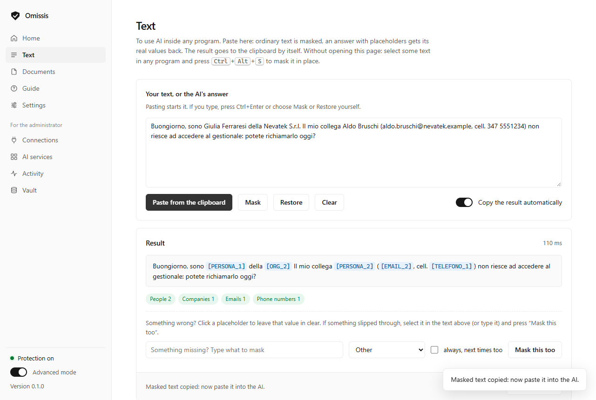
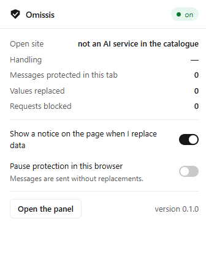

# Omissis

**Use AI assistants without handing them your personal data.**
Omissis replaces names, e-mail addresses, phone numbers, tax codes, IBANs, passwords, host names and
other sensitive values with placeholders (`[PERSONA_1]`, `[EMAIL_3]`…) *before* a prompt leaves your
computer, and puts the real values back into the answer. You read the real text; the AI service only
ever sees placeholders.

Everything runs locally: the detection model, the placeholder vault and the management panel. Nothing
is sent to any Omissis server, because there is none.

> **Status: beta.** The detection model is trained and measured. The connectors pass their automated
> tests against a mock service, but **live validation is still thin**: the terminal gateway has been
> verified live with Claude Code (a plain message and a file-writing action); the browser extension has not been verified with real accounts yet;
> the desktop-app connector, after failing its first live tests, now masks messages in the real ChatGPT
> desktop app (verified with one made-up message); Claude Desktop is untested.
> Test with made-up data first.
> The interface is in English and Italian. The detailed documentation is in Italian: see [README.it.md](README.it.md).







## What is in the box

| Part | What it does |
|---|---|
| **Model** (`model/`) | Italian-first PII detector: a token classifier on [mmBERT](https://huggingface.co/jhu-clsp/mmBERT-base) with 41 labels (28 identifiers always masked, 13 more on request), plus checksum rules (tax code, VAT number, IBAN, cards) and allow/deny lists |
| **Engine** (`app/engine.py`) | Local service on `127.0.0.1`: masks text and keeps a stable vault *placeholder ↔ value* in SQLite, so a conversation reopened days later can still be restored |
| **Browser extension** (`app/extension/`) | Chrome / Edge, Manifest V3. Works inside the page, before the request is encrypted: no proxy, no certificate. Also logs visits to AI services and can block them |
| **Terminal gateway** (`app/gateway.py`) | For Claude Code, Codex, opencode, aider and any tool with a configurable base URL: point it at `http://127.0.0.1:8767/<service>`. Masks prompts, tool results and past tool calls, restores text and new tool arguments. No certificate |
| **Desktop-app connector** (`app/connector.py`) | Experimental. Brings the same extension code into Chromium-based desktop apps (Claude, ChatGPT, Kimi, Copilot) through the debugging port; if the app is already open without protection it says so and, on request, closes it and reopens it protected |
| **Proxy** (`app/addon.py`) | A [mitmproxy](https://mitmproxy.org) addon for clients that speak the provider APIs or honour a proxy with a locally trusted certificate |
| **Manual tools** | For any app, with no traffic inspection. Select text anywhere and press `Ctrl+Alt+S`: it is masked in place. Mask / restore pasted text and correct the result by hand (leave a value in clear, mask one that slipped through, once or always), clipboard shortcuts (`Ctrl+Alt+M`, `Ctrl+Alt+R`; all three configurable, registered as Windows hotkeys so the program never sees other keystrokes), anonymise and restore Word, Excel, PowerPoint, text files and whole folders; scanned PDFs and images are read with the OCR built into Windows |
| **Panel** (`app/panel.py`) | Local web page + tray icon. A *simple* mode for everyday use (status, text, documents, guide) and an *advanced* mode for whoever manages it: activity log (counts only, never text), per-service policy (protect / log / block / ignore), Shadow AI inventory of the PC |
| **Vault** (panel) | Search a placeholder or a real value without revealing the others, delete chosen entries or the ones unused for N days, optional automatic clean-up. A deleted number is never reused, so an old placeholder can never be restored to a different value |
| **AI tool inventory** (`app/scan.py`, `app/inventory.py`) | Shadow AI on the PC, kept over time: installed AI apps, browser and editor extensions, CLI tools, local models, services contacted. Every scan (weekly by default) is saved and compared with the previous one: what appeared, what is gone, since when; a review (approved / to remove) and a note per item; CSV export. Names, versions and dates only, all local |
| **Compatibility register** (`app/compatibility.json` + panel) | Sites and apps change without notice. The panel records, on your PC only, which program and version each replacement last worked with (browser, desktop app, CLI tool) and flags the ones to re-check after an update; names, versions and counts, never text. `compatibility.json` lists what the author verified by hand |

## How it works

```
 you type ──► connector (extension / desktop connector / proxy)
                 │  text fields of the request
                 ▼
              engine on 127.0.0.1 ──► model + rules + lists ──► placeholders
                 │                         vault (SQLite, stays on the PC)
                 ▼
 AI service receives:  "Write to [PERSONA_1] ([EMAIL_1]) about ticket [ID_PRATICA_2]"
 AI service answers:   "Dear [PERSONA_1], ..."
                 │
                 ▼
 connector restores the values while the answer streams in ──► you read the real text
```

If the engine does not answer, protected requests are **blocked**, never forwarded in clear.

## The model

Two sizes, same labels and same training data: about one million texts, made of 200,000 synthetic
Italian documents written by our own generator and the training splits of nine public datasets in 23
languages. Everything is synthetic except two collections of court decisions, which contain names
that are already public in the decisions.

| | Parameters | Size | CPU latency* |
|---|---|---|---|
| `omissis-base` | 307.8 M | 1.2 GB | ~63 ms |
| `omissis-small` | 140.9 M | 537 MB | ~34 ms |

\* per short text on a desktop CPU, single thread of work.

On a private set of 2,000 real IT help-desk texts (not releasable; the thresholds were chosen on a
second set kept apart), measured as *share of known sensitive values that ended up masked*, and on
the public benchmark [PIIMB](https://huggingface.co/datasets/piimb/pii-masking-benchmark) (about
150,000 sentences in six tasks, character level, model weights alone):

| | Known values protected | Share of text masked | Company names in free text | PIIMB, average F2 |
|---|---|---|---|---|
| `omissis-base` | 98.8 % | 17.0 % | 94 % | 0.911 |
| `omissis-small` | 98.8 % | 17.2 % | 92 % | 0.912 |

Measured on 13 November 2026. The best of the other 36 models listed by PIIMB scores 0.836 on
average; ours are first on average, not in every task, and the training splits of the same datasets
are among their training data (the test splits were never used).

How the two models compare with other PII detectors (OpenAI's privacy-filter, Presidio, the best models of
the public list), on the public benchmark, on Italian and on real texts: [docs/BENCHMARKS.md](docs/BENCHMARKS.md).

What these numbers are **not**: precision on real text has not been measured yet (it needs a
hand-labelled set, which is being prepared), and "known values" are those that could be derived from
ticket metadata, not every sensitive value in the text. Details and limits are in the model cards under
[`huggingface/`](huggingface/).

Weights are published on Hugging Face (`francescogruner/omissis-base`, `francescogruner/omissis-small`)
and downloaded with `model/download_model.py`; they are not stored in this repository.

## Quick start (Windows)

**With the installer** (if you just want to use it): download `Omissis-<version>-setup.exe` from the
[releases page](https://github.com/francescogruner/omissis/releases/latest). No Python and no
administrator rights needed. On first start the program downloads the model (once), then works
offline; updates arrive on their own and are accepted only if signed by the author (you can switch
to "notify only" or "never"). The installer is not code-signed yet, so Windows shows the SmartScreen
warning.

**From source** (if you want to read or change the code):

Requires Python 3.12. The app and the model use two separate environments.

```
git clone https://github.com/francescogruner/omissis
cd omissis
py -3.12 -m venv app\.venv
app\.venv\Scripts\pip install -r app\requirements.txt
py -3.12 -m venv model\.venv
model\.venv\Scripts\pip install -r model\requirements-light.txt
model\.venv\Scripts\python model\download_model.py omissis-small
app\.venv\Scripts\python app\panel.py
```

This is the **light install**: the model runs on the CPU in ONNX format, without PyTorch (about
150 MB of libraries instead of several GB), and finds exactly the same data as the PyTorch engine
(`model/compare_engines.py` checks it). To use a GPU, install `model\requirements.txt` instead.

The panel opens at `http://127.0.0.1:8766`. From there: mask a text by hand (section *Testo*),
anonymise documents (*Documenti*), load and pair the browser extension (*Browser*).
Everything else is in [app/README.it.md](app/README.it.md).

## What Omissis does not protect you from

Be clear about the limits before relying on it:

- **It is a filter, not a guarantee.** A detection model misses things. Use the *always mask* list
  for terms it cannot know (project code names, internal identifiers).
- **Restored values are visible to the page.** When the answer is restored inside the service's own
  page or app, that page's scripts can read it. Turn restoring off and use `Ctrl+Alt+R` on copied
  text if that matters to you.
- **Attachments:** in the extension and in desktop apps the attached file is replaced with its anonymised copy
  (Word, Excel, PowerPoint, text; PDFs and images containing text become text). Tested against the mock service,
  not yet on real sites. An image with no readable text goes as it is.
- **Not covered yet:** files uploaded by tools that only go through the proxy or the gateway (they can be
  blocked), WebSocket traffic, requests made from web workers.
- **Coding agents get a lot of context masked.** Through the gateway, file contents and command
  output are masked in full; this protects more but can confuse the model on long working sessions.
- **The vault is encrypted with Windows DPAPI**, tied to your Windows user: a copied file cannot be
  opened elsewhere. It does not protect against malware already running under your own account.
- **The desktop-app connector is experimental**: it relies on the app's debugging port, which the
  vendor may restrict at any time and which any local program can use while the app is open.

See [SECURITY.md](SECURITY.md) for the threat model and how to report a problem.

## Roadmap

- Validation against live accounts, service by service
- Tuning of what gets masked in coding-agent contexts; live validation of the OpenAI-format gateway
- Code signing for the installer and Microsoft Store publication
- Native messaging instead of the local HTTP bridge for the extension; store publication
- Firefox
- Redacted image output for scans; automatic restore of files downloaded from chats
- Central console for organisations (policies, deployment, compliance log)

## Licence

Code and model weights: [Apache License 2.0](LICENSE). Third-party components and their licences:
[THIRD_PARTY.md](THIRD_PARTY.md). "Omissis" as a product name is not covered by the licence grant
(section 6 of the licence).

Made by [Francesco Gruner](https://github.com/francescogruner).
