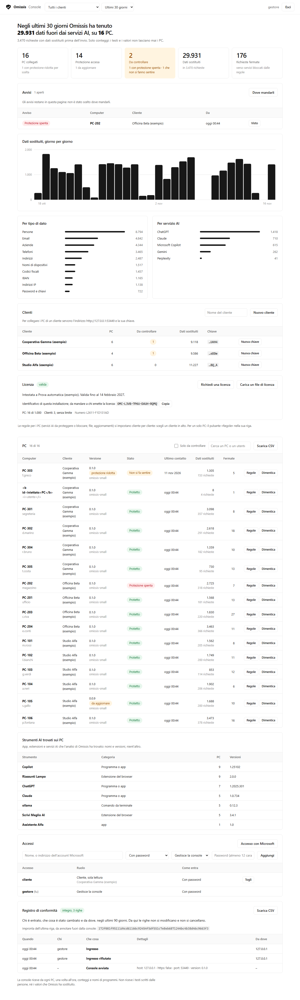

# Console centrale di Omissis

Per le organizzazioni e gli MSP che usano Omissis su più PC: una pagina sola che mostra, cliente per cliente, quanti
PC hanno Omissis, quali vanno controllati (protezione spenta, PC che non si fanno sentire, versioni vecchie) e quanti
dati sono stati tenuti fuori dai servizi AI, in totale, per giorno, per tipo di dato e per servizio. Riceve solo
conteggi e nomi di programmi: mai i testi scritti dalle persone, mai i valori sostituiti.



English: [README.md](README.md).

## Che cosa si fa da lì

- **Regole per i PC**: quali servizi AI proteggere o bloccare, i file, gli aggiornamenti, il divieto di spegnere la
  protezione, fissati per cliente e mandati ai PC che hanno scelto di accettarli; un singolo PC può avere regole sue,
  sopra quelle del cliente. La console può cambiare le regole, non a chi i PC mandano i dati.
- **Avvisi**: un PC che spegne la protezione, uno che non si fa più sentire, uno strumento AI nuovo. Nella pagina, a un
  indirizzo web (Teams, Slack) o per posta.
- **Registro di conformità**: chi è entrato e che cosa ha cambiato, con il CSV da dare a chi fa un controllo e una
  catena di impronte che scopre le righe ritoccate.
- **Accessi**: con nome e password, oppure con l'account Microsoft dell'organizzazione (Entra ID).

## Gratis fino a 5 PC

La console è **gratuita fino a 5 PC di un solo cliente**, senza scadenza e senza registrarsi. Per seguire più PC o
più clienti si chiede una licenza dalla console stessa (scheda «Licenza» → «Richiedi una licenza»): prepara un file
con l'identificativo della tua installazione, lo mandi, e ricevi un file di licenza da caricare nella stessa scheda.

## Non è software aperto

Il programma Omissis che gira sui PC è aperto (Apache 2.0) e sta in questo repository. La console è un programma a
parte, proprietario: viene distribuita **compilata**, il suo codice sorgente non è qui, e le sue condizioni d'uso
sono in [LICENZA.it.md](LICENZA.it.md). Ciò che i PC le mandano è aperto e documentato (`app/central.py`, e il
pannello di ogni PC mostra il riepilogo esatto prima che parta).

## Scaricare e installare (Windows)

1. Scarica `omissis-console-<versione>.zip` dalla
   [pagina delle versioni](https://github.com/francescogruner/omissis/releases/latest) e scompattalo sul computer
   che farà da server (Windows 10/11 o Windows Server; basta 1 GB di memoria).
2. Da PowerShell aperto come amministratore, nella cartella scompattata:

   ```powershell
   powershell -ExecutionPolicy Bypass -File .\Install-Console.ps1
   ```

3. Su quello stesso computer apri `https://127.0.0.1:8800/`: la pagina ti fa creare il tuo accesso e poi ti
   accompagna nei primi passi (creare un cliente, dare il file ai PC, aspettare il primo riepilogo).

Di serie la console è per la rete locale: fa HTTPS con un certificato che si crea da sé, e i PC la riconoscono
dall'impronta di quel certificato. Niente nome pubblico, niente porte 80 e 443, nient'altro da installare. La guida
completa, con la messa in rete su Internet, le copie di sicurezza e i problemi tipici, è in [GUIDA.it.md](GUIDA.it.md).

## Che cosa è provato e che cosa no

Le prove automatiche, su un solo computer, coprono le chiamate della console, la pagina, la licenza, il primo avvio
e il pacchetto compilato installato senza attività pianificate. Regole, avvisi e registro sono provati in automatico con il programma vero e con destinazioni finte; l'ingresso con
l'account Microsoft solo contro un servizio di accesso finto, non con un'organizzazione vera. Non ancora provato: un PC che si collega da
un'altra macchina della rete, il riavvio del server e la copia notturna, l'installazione del pacchetto compilato da
amministratore. Il programma non è firmato: Windows può mostrare un avviso quando lo si lancia.
