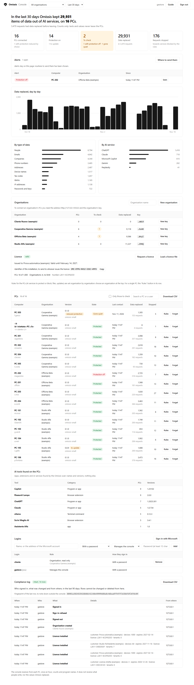

# Omissis central console

For organisations and MSPs that run Omissis on several PCs: one page that shows, customer by customer, how many
PCs have Omissis, which ones need attention (protection off, PCs gone quiet, old versions) and how much data was
kept away from AI services, in total, per day, per type of data and per service. It receives counts and program
names only: never the texts people write, never the replaced values.



Italiano: [README.it.md](README.it.md).

## Free up to 5 PCs

The console is **free up to 5 PCs of a single customer**, with no time limit and nothing to register. To follow
more PCs or more customers you ask for a licence from the console itself ("Licence" card → "Request a licence"):
it prepares a file with the identifier of your installation, you send it, you get back a licence file to load in
the same card.

## It is not open source

The Omissis program that runs on the PCs is open (Apache 2.0) and lives in this repository. The console is a
separate, proprietary program: it is distributed **compiled**, its source code is not here, and its terms of use
are in [LICENSE.md](LICENSE.md). What the PCs send to it is open and documented (`app/central.py`, and the panel
of each PC shows the exact summary before it leaves).

## Download and install (Windows)

1. Download `omissis-console-<version>.zip` from the
   [releases page](https://github.com/francescogruner/omissis/releases/latest) and unzip it on the computer that
   will act as server (Windows 10/11 or Windows Server; 1 GB of memory is enough).
2. From PowerShell opened as administrator, in the unzipped folder:

   ```powershell
   powershell -ExecutionPolicy Bypass -File .\Install-Console.ps1
   ```

3. On that same computer open `https://127.0.0.1:8800/`: the page asks you to create your login, then walks you
   through the first steps (create a customer, give the file to the PCs, wait for the first summary).

By default the console is for the local network: it speaks HTTPS with a certificate it makes itself, and the PCs
recognise it by the fingerprint of that certificate. No public name, no ports 80 and 443, nothing else to install.
The whole guide, with the Internet-facing setup, backups and troubleshooting, is in [GUIDE.md](GUIDE.md).

## What has been tested, and what has not

Automatic tests on a single computer cover the console's calls, the page, the licence, the first start and the
compiled package installed without scheduled tasks. Not tested yet: a PC connecting from another machine on the
network, the server restart and the nightly backup, the installation of the compiled package as administrator.
The program is not code-signed: Windows may warn when you run it.
