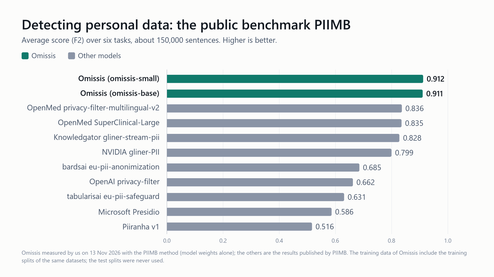
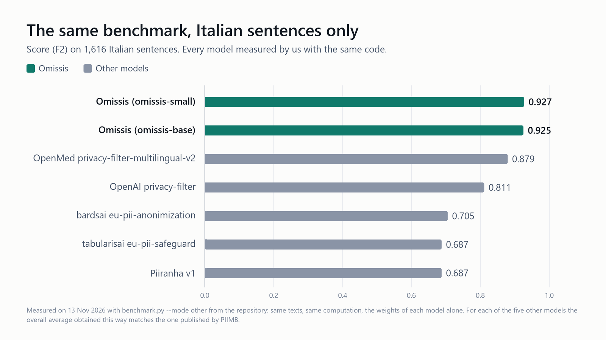
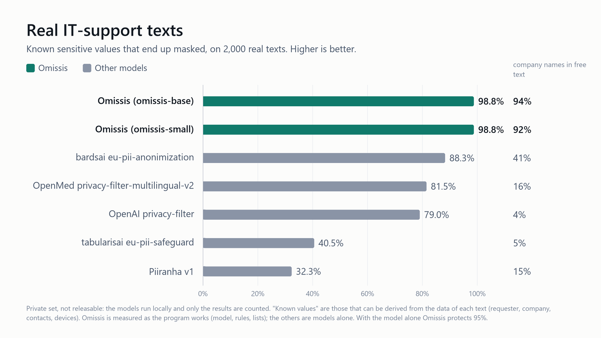

# Omissis next to other PII detectors

Measured on 13 November 2026. Everything about the public benchmarks can be redone with the code in
[`model/`](../model/); the last section says how.

## In three lines

- On the public benchmark PIIMB the two Omissis models score **0.91** on average; the best of the other 36
  models listed **0.84**; OpenAI's privacy-filter 0.66; Microsoft Presidio 0.59.
- On the **Italian** sentences of the same benchmark: Omissis **0.93**, the best of the others 0.88.
- On **2,000 real IT-support texts** Omissis protects **98.8%** of the known sensitive values; the best of
  the others 88%, OpenAI's model 79%.

## 1. The public benchmark PIIMB

[PIIMB](https://huggingface.co/datasets/piimb/pii-masking-benchmark): about 150,000 sentences in six tasks,
scored at character level without looking at the label. The score is F2, which weighs a missed character
more than one masked needlessly.



| Model | Average | ai4privacy-en | ai4privacy-multi | nemotron-pii | gretel | privy | mapa-eur-lex |
|---|---|---|---|---|---|---|---|
| **omissis-small** | **0.912** | 0.988 | 0.991 | 0.970 | 0.976 | 0.941 | 0.605 |
| **omissis-base** | **0.911** | 0.988 | 0.992 | 0.970 | 0.974 | 0.940 | 0.600 |
| OpenMed/privacy-filter-multilingual-v2 | 0.836 | 0.975 | 0.970 | 0.907 | 0.973 | 0.818 | 0.373 |
| OpenMed/OpenMed-PII-SuperClinical-Large-434M-v1 | 0.835 | 0.944 | 0.899 | 0.963 | 0.945 | 0.734 | 0.525 |
| knowledgator/gliner-stream-pii-v1.0 | 0.828 | 0.957 | 0.921 | 0.833 | 0.939 | 0.904 | 0.411 |
| nvidia/gliner-PII | 0.799 | 0.945 | 0.913 | 0.772 | 0.920 | 0.714 | 0.531 |
| bardsai/eu-pii-anonimization-multilang | 0.685 | 0.831 | 0.843 | 0.715 | 0.890 | 0.575 | 0.254 |
| openai/privacy-filter | 0.662 | 0.843 | 0.805 | 0.607 | 0.869 | 0.536 | 0.313 |
| tabularisai/eu-pii-safeguard | 0.631 | 0.805 | 0.833 | 0.610 | 0.848 | 0.545 | 0.144 |
| presidio (en_core_web_lg) | 0.586 | 0.734 | 0.622 | 0.729 | 0.758 | 0.518 | 0.154 |
| iiiorg/piiranha-v1-detect-personal-information | 0.516 | 0.803 | 0.813 | 0.360 | 0.607 | 0.369 | 0.146 |

The Omissis rows are measured by us with the PIIMB method (model weights alone, most likely class); the
others are the results published by PIIMB.

## 2. Italian, CVs, size: same texts, same code

Five models were measured by us with the same code used for ours (`benchmark.py --mode other`: the weights
alone, most likely class, whatever is not "O" counts as masked). For each of the five the PIIMB average
obtained this way matches the published one (0.840 against 0.836, 0.664 against 0.662, 0.686 against 0.685,
0.634 against 0.631, 0.518 against 0.516): it is the same measurement.



| Model | Parameters | PIIMB, Italian sentences (1,616) | CV-PII-Bench holdout (40 CVs) | Time per text* |
|---|---|---|---|---|
| **omissis-small** | 141 M | **0.927** | 0.708 | 0.5 ms |
| **omissis-base** | 308 M | **0.925** | 0.752 | 0.6 ms |
| OpenMed/privacy-filter-multilingual-v2 | 1,400 M | 0.879 | 0.614 | 16.7 ms |
| openai/privacy-filter | 1,400 M | 0.811 | 0.605 | 32.5 ms |
| bardsai/eu-pii-anonimization-multilang | 278 M | 0.705 | **0.837** | 0.4 ms |
| tabularisai/eu-pii-safeguard | 559 M | 0.687 | 0.540 | 0.9 ms |
| iiiorg/piiranha-v1-detect-personal-information | 278 M | 0.687 | 0.455 | 1.2 ms |

\* averaged over the 150,000 benchmark sentences on an RTX 4080 SUPER, with our measuring code.

Where we are not first: on the **CVs** the bardsai model does better (0.837) than ours with all 41 labels on
(0.75 and 0.71), because that way ours mask too much (precision 41%). As the Omissis program ships, with the
28 identifiers only, the score on the CVs is 0.840: level.

## 3. Real IT-support texts

2,000 real texts, a private set that cannot be released: the models run locally and only the results are
counted. "Known values" are those that can be derived from the data attached to each text (requester,
company, contacts, devices).



| Model | Known values protected | Company names in free text | Computer and server names | Text masked |
|---|---|---|---|---|
| **omissis-base** (as the program works) | **98.8%** | **94%** | **100%** | 17.0% |
| **omissis-small** (as the program works) | **98.8%** | **92%** | **100%** | 17.2% |
| omissis-base (model alone) | 95.1% | 92% | 100% | 20.0% |
| bardsai/eu-pii-anonimization-multilang | 88.3% | 41% | 91% | 18.2% |
| OpenMed/privacy-filter-multilingual-v2 | 81.5% | 16% | 27% | 14.7% |
| openai/privacy-filter | 79.0% | 4% | 5% | 11.9% |
| tabularisai/eu-pii-safeguard | 40.5% | 5% | 0% | 9.1% |
| iiiorg/piiranha-v1-detect-personal-information | 32.3% | 15% | 5% | 6.1% |

This is where a model built for the job shows: customer names, machine names, credentials. The other models
were made for something else (forms, documents, English text) and were never tried on this kind of data.

## How to read these numbers

- **Home advantage on the public benchmark.** The training splits of the datasets PIIMB draws its texts from
  are among the training data of Omissis. The test sentences were never used, but a model that has seen those
  families of data has an advantage; some of the other models have seen them, some have not.
- **First on average, not everywhere.** In three tasks out of six another model scores more than ours
  (nemotron-pii 0.972, gretel 0.983, privy 0.987), and on the CVs bardsai is ahead with every label on.
- **The real texts are our own field.** The set is private, so nobody can redo the measurement, and it is the
  kind of text Omissis is built for. The comparison is honest, not neutral.
- **Precision on real text is still missing.** We know how many known values are covered and how much text is
  masked, not how many of the masked pieces had to be: that needs a hand-labelled set, which is being prepared.
- **Legal text.** On court documents (mapa-eur-lex) every model does badly, ours included: 0.60.
- Models driven by instructions (GLiNER and similar) and Presidio were not run by us: for them only the
  published PIIMB results are quoted.

## Redo the measurements

```
python benchmark.py models\omissis-base --mode model --profile strict --save
python benchmark.py OpenMed/privacy-filter-multilingual-v2 --mode other --save
python leaderboard.py
```

The first command downloads the benchmarks (data files only); the second downloads the named model from
Hugging Face (weights in safetensors only, no code from the model repository is run) and measures it with the
same code; the third puts everything next to the published list.
